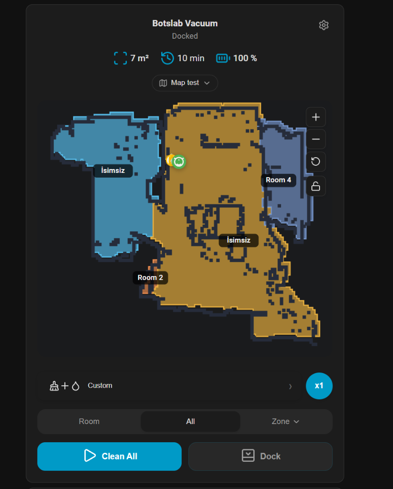
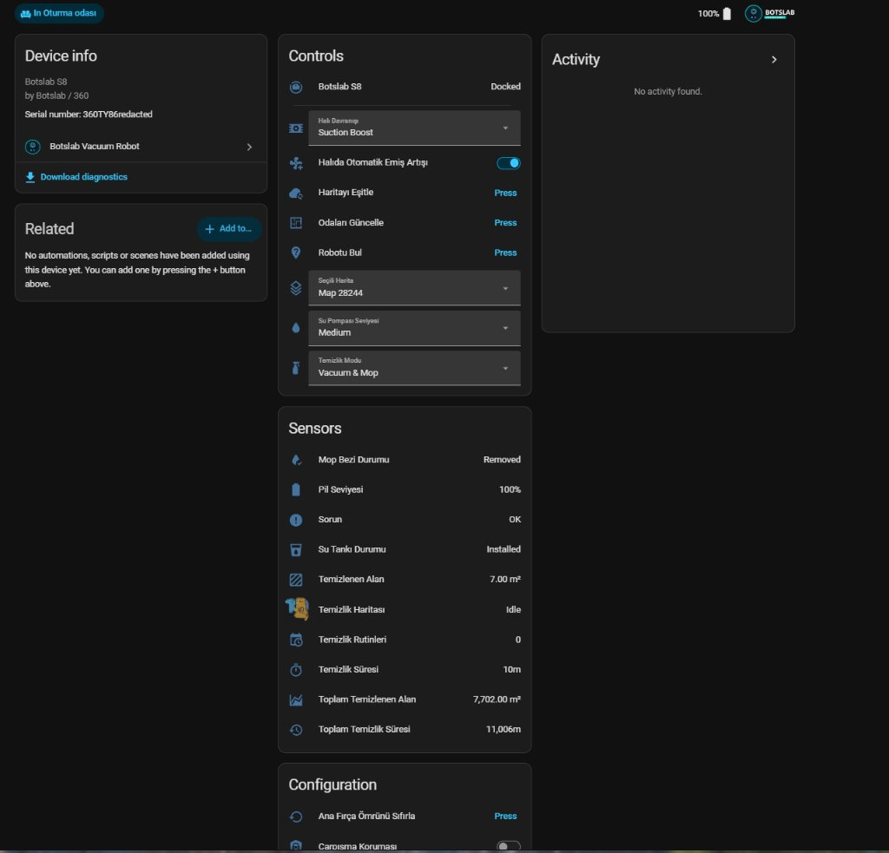
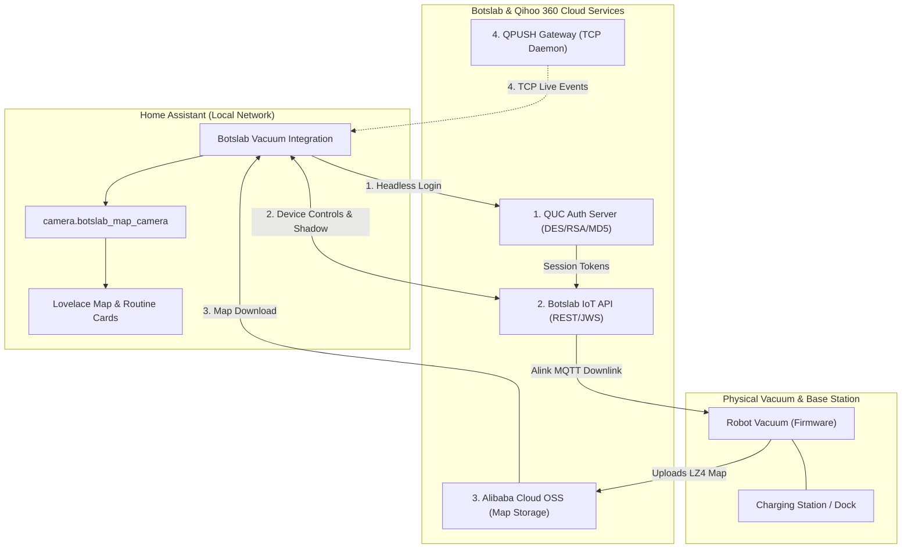
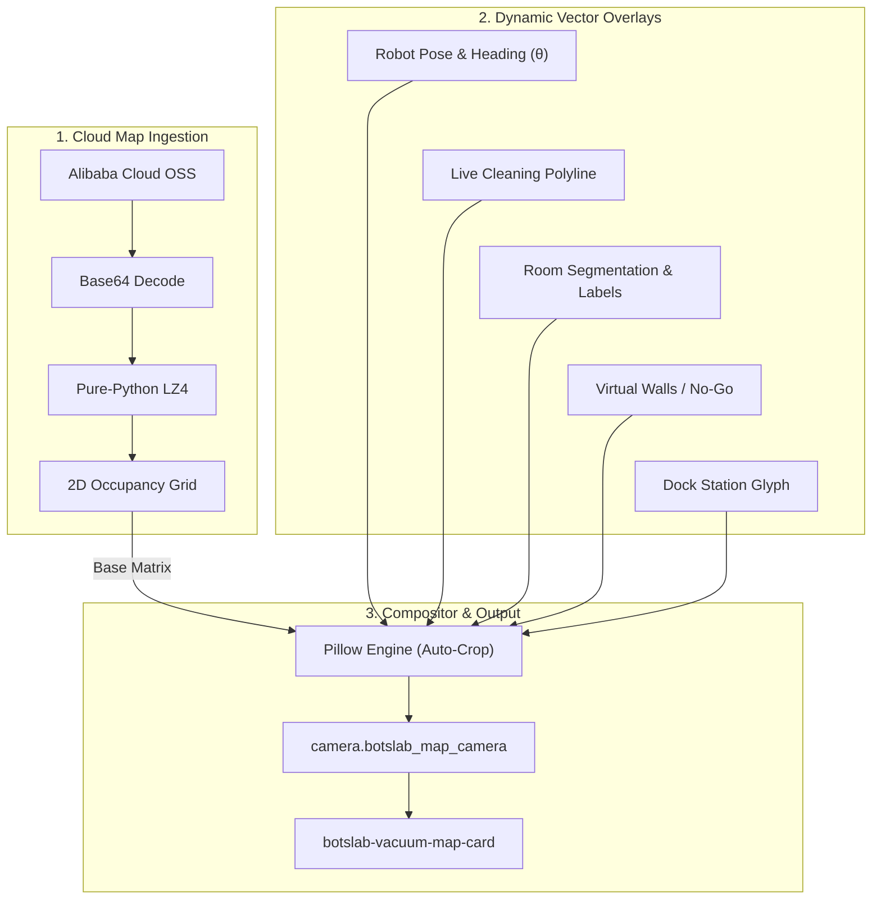

# Botslab Vacuum Robot — Home Assistant Integration

[](#)
[](README.tr.md)
[](https://www.home-assistant.io)
[](https://hacs.xyz)
[](LICENSE)
[](https://www.python.org)

Production-ready Home Assistant integration for **Botslab** and **Qihoo 360** robot vacuum cleaners. Connects directly to the Botslab Cloud via headless **QUC Authentication** (DES + RSA + MD5 signature generation) and exposes vacuum controls, sensors, room cleaning, and live telemetry to Home Assistant.

---

## 📸 Screenshots

<table>
  <tr>
    <td align="center" width="42%">
      <br />
      <sub><b>Interactive Map Card</b> (<code>botslab-vacuum-map-card</code>)</sub>
    </td>
    <td align="center" width="58%">
      <br />
      <sub><b>Device Controls, Sensors & Diagnostics</b></sub>
    </td>
  </tr>
</table>

---

## 📱 Supported Devices

| Model | Status | Notes |
|---|---|---|
| **Botslab S8** | ✅ **Supported & Verified** | Confirmed working on hardware. Full controls, room cleaning, telemetry, map |
| **Qihoo 360 S6** | ✅ **Supported & Verified** | Community tested and verified via China Mainland backend ([Issue #1](https://github.com/srg-n/ha-botslab-vacuum/issues/1)). Full vacuum controls, telemetry, live map, consumables |
| **Botslab S8 Plus** | ⚠️ **Untested (Expected to work)** | Same TSL cloud API architecture — feedback and testing welcome |
| **Botslab S7 / S9 / S10** | ⚠️ **Untested (Expected to work)** | Same cloud API architecture via International or China backend |
| **Qihoo 360 (S5, S7, S9, X90)** | ⚠️ **Experimental Support** | Protocol implementation via China Mainland (360 Smart Life) region |

> 💡 **Which Server Region Should You Choose? (Golden Rule)**
> The choice depends **strictly on the mobile app your vacuum is registered in**, NOT where you physically live:
> 
> 1. **If your vacuum is in the "360 Robot" or "360 Smart Life" app (e.g. 360 S5, S6, S7, S9, X90):**
>    - **Select:** **`China Mainland (360 Smart Life)` (`cn`)**
>    - ⚠️ **Even if you live in Europe, UK, Turkey, or North America**, you **must select `China Mainland (360 Smart Life)`**! Legacy 360 vacuums connect through Qihoo's central cloud infrastructure (`q.smart.360.cn` / `passport.360.cn`). Selecting `Europe 1` will fail with *Account not found*. Use your existing 360 app email and password.
> 
> 2. **If your vacuum is in the modern "Botslab" app (e.g. Botslab S8, S8 Plus, or newer models):**
>    - **Select:** Your geographical region (e.g. **`Europe 1 (Frankfurt)`** for Europe/UK/Turkey, **`North America`** for US/Canada, etc.).
>    - These models use the modern regional Botslab IoT cloud (`*-sapp-api.botslab.com`).

---

## 🌟 Key Features

- 🔐 **Headless Auto-Login & Self-Healing:** No ADB, no root, no network sniffing or proxy setups required. Simply provide your Botslab mobile app email and password.
- 🔄 **Autonomous Session Self-Healing:** Automatically detects and recovers from session evictions (`102003` *"logged in on another device"*, `1015`) caused by opening the official mobile app. Re-authenticates headlessly in the background and transparently retries commands without manual re-login.
- 📐 **Cryptographic Cloud-Shadow Architecture:** Full headless QUC session bootstrapping (DES-CBC `parad` + RSA-1024 `key` + MD5 `sig`), dynamic query signing (`md5(appkey + m2 + sign_ts + sign_no + secret)`), and Base64 JWS authorization header management.
- 🧹 **Comprehensive Vacuum Controls:**
  - Start / Clean, Pause, Stop, Return to Base (Dock)
  - Fan Speed selection (`Quiet`, `Standard`, `Medium`, `Max`)
  - Water Level selection (`Low`, `Medium`, `High`)
  - Cleaning Mode selection (`Vacuum & Mop`, `Vacuum Only`, `Mop Only`)
  - Find / Locate Robot audio trigger (`locate`)
- 🚪 **Dynamic Room Cleaning & No-Go Zones:**
  - Automatically identifies partitioned rooms from your map
  - Exposes room cleaning actions/services directly in Home Assistant
  - **No-Go & No-Mop Zones (`SetZones` / `SetFbdPlaces`):** Interactively add, delete, and persist virtual forbidden cleaning boxes, no-mop zones, and virtual walls directly via Home Assistant services and UI cards
- 🗺️ **Pure-Python Map Pipeline & Built-in Cards:**
  - Direct download from Alibaba Cloud OSS, Base64 decoding, and zero-dependency LZ4 occupancy grid decompression
  - Dynamic Pillow server-side rendering eliminating black void borders (auto-crop)
  - Dock station glyph, live cleaning path polyline, and robot heading orientation arrow
  - Zero-config bundled Lovelace cards:
    - **`botslab-vacuum-map-card`**: Modern, native interactive card with visual UI editor, sequential room ordering (1 -> 2), customized per-room suction and water flow settings, free zone cleaning, and spot cleaning (adapted from *noambergauz/dreame-vacuum-map-card*).
    - **`botslab-routines-card`**: Full cleaning schedule and routines manager with visual card editor and automatic bilingual EN/TR support.
- 📡 **Dynamic QPush Gateway & Real-time Live Telemetry:**
  - Dynamic GSLB push gateway resolution via `dp.push.dc.360.cn` supporting raw binary TCP on Port 443 (primary) and Port 80 (fallback)
  - Real-time millimeter Cartesian coordinates $[x, y, \theta]$ and live cleaning path exposed in camera and vacuum attributes
- ⏱️ **Two-Stage Polling & Safety Watchdog Engine:**
  - **Active Cleaning (5s):** Rapid 5-second polling with prioritized Alibaba OSS `1days` live map streaming
  - **Firmware Safety Watchdog:** Automatic 50s keepalive loop with 60s safety timeout (`StartSyncMapPkgToOss`), instantly terminated (`StopSyncMapPkgToOss`) when cleaning ends to preserve robot CPU and Wi-Fi bandwidth
  - **Idle / Docked (5 minutes):** 300-second idle polling interval, instantly awakened by the persistent QPush TCP daemon upon any state transition or error
- ⏱️ **HA-Driven Routine & Schedule Engine:**
  - Multi-room, suction-customizable scheduled cleaning routines
  - Persisted in Home Assistant storage (survives restarts)
  - Dedicated schedule sensor and custom Lovelace routines management card
- ⚡ **Dynamic State Transition Watcher:**
  - Fast-polling verification loop (1.5s interval) catches cloud status changes immediately upon user commands
  - Zero UI lag when starting, pausing, or docking without relying on fake optimistic states
- 📊 **Consumables & Maintenance Sensors:**
  - HEPA Filter remaining lifetime (hours)
  - Main Brush remaining lifetime (hours)
  - Side Brush remaining lifetime (hours)
  - Sensor maintenance status (hours)
  - Total cleaning area (m²) and cleaning duration (hours)
  - Error code and diagnostic status
- ⚙️ **Switches & Settings:**
  - Carpet Auto-Boost toggle
  - Collision Protection toggle
  - Button Backlight toggle
  - Voice Volume Level slider (`0 - 100%`)

---

## 🚀 Installation

### Option 1: Official HACS Default Repository (RECOMMENDED) ⭐

The integration is officially included in the **HACS default repository** list! You can search and install it directly without manually adding custom URLs:

1. Open **HACS** in your Home Assistant sidebar ➔ navigate to **Integrations**.
2. Click the **Explore & Download Repositories** button (or the search icon).
3. Search for **Botslab Vacuum Robot**.
4. Click on the card and select **Download**.
5. Restart Home Assistant (**Settings ➔ System ➔ Restart**).

---

### Option 2: Custom Repository (Alternative / Direct from Git)

If you wish to track bleeding-edge git commits directly, or if your local HACS catalogue has not refreshed yet:

#### Via Home Assistant Marketplace (HA 2026+):
1. Open **Marketplace** in your Home Assistant sidebar (or go to **Settings ➔ System ➔ Marketplace**).
2. Click the **three dots** (`⋮`) in the top right corner and choose **Custom repositories**.
3. In the Repository field, enter:
   ```text
   https://github.com/srg-n/ha-botslab-vacuum
   ```
4. Select **Integration** as the Category and click **Add**.
5. Search for **Botslab Vacuum Robot** and click **Install**.
6. Restart Home Assistant (**Settings ➔ System ➔ Restart**).

#### Via HACS Custom Repository:
1. Open **HACS** in your Home Assistant sidebar ➔ navigate to **Integrations**.
2. Click the **three dots** (`⋮`) in the top right corner and choose **Custom repositories**.
3. In the Repository field, enter `https://github.com/srg-n/ha-botslab-vacuum`, select **Integration** as the Category, and click **Add**.
4. Find **Botslab Vacuum Robot** in the list and click **Download**.
5. Restart Home Assistant (**Settings ➔ System ➔ Restart**).

#### Account Setup & Region Selection:
After restarting, go to **Settings ➔ Devices & Services ➔ Add Integration**, search for **Botslab Vacuum**, and log in:
- **For Botslab models (e.g., S8, S8 Plus):**
  - Select **`Asia Pacific`** first if your account was created in Turkey, Middle East, or Asia Pacific.
  - Or select **`Europe 1 (Frankfurt)`**, **`Europe 2`**, or **`North America`** matching your Botslab app account region.
- **For Legacy Qihoo 360 models (e.g., S5, S6, S7, S9, X90):**
  - Select **`China Mainland (360 Smart Life)`** (regardless of where you live in the world) and enter your 360 Smart Life app credentials.

---

## 🎨 Home Assistant Dashboard & Built-in Cards

The integration includes two **built-in Lovelace cards** served directly by Home Assistant. No separate card downloads or manual JavaScript resource configurations are needed!

### 1. `botslab-vacuum-map-card` (Interactive Map Card)

An interactive, high-performance map card crafted specifically for Botslab vacuums:

- **Sequential Room Cleaning:** Click rooms on the map to clean them. Ordered badges (`1`, `2`, `3`) indicate the exact cleaning sequence.
- **Auto-Order Toggle:** Switch between strict sequential order (1 -> 2) or letting the robot calculate the shortest route.
- **Per-Room Customization:** Fine-tune suction power, water level, and repeat passes (1x or 2x) independently for each room.
- **Zone Cleaning:** Draw custom rectangular cleaning areas directly over the map.
- **Spot Cleaning / Go To Point:** Tap anywhere on the floor plan to dispatch the robot to that coordinate.
- **Live Overlays:** Live robot location marker with orientation heading arrow, charging dock glyph, and real-time path polyline.
- **Interactive Controls:** Smooth pan, zoom, and 90° map rotation.
- **Visual Card Editor:** Full graphical configuration UI with entity pickers and immediate live preview.

#### How to Add the Map Card:
1. Open your dashboard, click the **three dots (⋮)** in the top right corner, and select **Edit Dashboard**.
2. Click **+ Add Card** at the bottom right.
3. In the search box, type **Botslab** and select **Botslab Vacuum Map Card**.
4. The visual editor automatically selects your `vacuum.*` and `camera.*_map_camera` entities.
5. Click **Save**!

Or via YAML / Manual card:
```yaml
type: custom:botslab-vacuum-map-card
entity: vacuum.botslab_vacuum
map_entity: camera.botslab_map_camera
title: Botslab Vacuum
default_mode: room
# auto_order: false   # false (default): cleans in selection order (1 -> 2). true: robot auto-routes.
```

---

### 2. `botslab-routines-card` (Cleaning Routines & Schedules)

A dedicated card for managing automated cleaning schedules directly from your dashboard:

- **Schedule Management:** Create, toggle, edit, or delete cleaning schedules without opening the mobile app.
- **Day & Time Selection:** Set target execution time (HH:MM) and repeating days of the week.
- **Room & Power Customization:** Choose specific rooms, suction power levels, and repeat cycles for each routine.
- **Visual Card Editor:** Easily select your robot vacuum entity via dropdown or UI form.
- **Bilingual Interface:** Automatically displays in English or Turkish based on your Home Assistant user profile.

#### How to Add the Routines Card:
1. In Edit Dashboard mode, click **+ Add Card**.
2. Search for **Botslab** and select **Botslab Routines Card**.
3. Select your vacuum entity in the dropdown.
4. Click **Save**!

Or via YAML / Manual card:
```yaml
type: custom:botslab-routines-card
entity: vacuum.botslab_vacuum
```

---

## 📚 Documentation & Technical References

For in-depth protocol analysis, payload schemas, and system design, refer to the technical guides in `docs/`:

- [Protocol Specification (`docs/PROTOCOL.md`)](docs/PROTOCOL.md) — Wire protocol, signing algorithms, QUC auth steps, and Alibaba Cloud OSS / Alink interactions.
- [Control & Payload Reference (`docs/CONTROL.md`)](docs/CONTROL.md) — Exhaustive catalog of cloud commands (`SetFbdPlaces`, `StartCleanInAreas`, etc.), service payload schemas, and room cleaning formats.
- [Integration Architecture (`docs/ARCHITECTURE.md`)](docs/ARCHITECTURE.md) — System flow, hybrid QPUSH + adaptive polling model, Pillow map rendering pipeline, and routine engine internals.

---

## 🔬 Technical Architecture & Protocol Internals

The integration communicates with Botslab devices via a proprietary **Cloud-Shadow Device Architecture**. The robot vacuum never accepts incoming local socket connections on your home network; it maintains an outbound Alink (Alibaba Cloud IoT) MQTT downlink tunnel to the regional cloud broker.



### 1. Cloud-Shadow Device Architecture
* **Zero Incoming Local Ports:** The vacuum does not expose a local HTTP/REST server or local WebSocket port. All interactions pass through the regional Botslab IoT cloud backend (`*-sapp-api.botslab.com`).
* **Bidirectional Shadow Synchronization:**
  - **Uplink:** The robot streams property states (battery level, working status, consumable wear, current coordinates) to its device shadow.
  - **Downlink:** Home Assistant dispatches action requests via `POST /v1/device/service/invoke`, which the cloud pushes through Alink MQTT directly to the robot's active socket.

### 2. Headless Authentication Bootstrapping
Authentication is negotiated headlessly without ADB, rooting, or proxy tools:

| Stage | Endpoint | Cryptographic Primitive | Result |
|---|---|---|---|
| **1. 360 QUC Login** | `POST https://passport.360.cn/request.php` (or regional login host) | • Form parameters encrypted with **DES-CBC** (`parad`)<br>• Symmetric key material encrypted with **RSA-1024** (`key`)<br>• Request signature generated with **MD5** (`sig`) | Account session cookies: **`Q`** and **`T`** |
| **2. Botslab App Login** | `POST https://*-sapp-api.botslab.com/v1/app/login` | • Exchanges `Q` and `T` tokens with hardware-bound `m2` identifier | API session token: **`sid`** & **`push_alias`** |

### 3. Request Signing & Authorization Header
Every HTTPS request dispatched to `*-sapp-api.botslab.com` requires two layers of cryptographic authentication:

#### A. Cryptographic Query Signature
URL query parameters must include a tamper-resistant MD5 signature:
```text
sign = MD5(appkey + m2 + sign_ts + sign_no + secret)
```
* **`appkey`**: Regional client application key embedded in the mobile client.
* **`m2`**: Unique client installation identifier generated during initial config flow.
* **`sign_ts`**: Unix epoch timestamp in milliseconds (`time.time() * 1000`).
* **`sign_no`**: Cryptographic nonce (16-char random hex string).
* **`secret`**: Secret signing key corresponding to the client `appkey`.

#### B. JWS Authorization Header
All device endpoints require an `Authorization` header carrying a Base64-encoded JSON Web Signature (JWS) payload:
```http
Authorization: jws <base64({ "q": "<Q>", "t": "<T>", "sid": "<sid>" })>
```

### 4. Autonomous Session Self-Healing (Multi-Device Recovery)
> [!IMPORTANT]
> **Single-Session Policy:** Botslab cloud enforces strict single-session concurrency per user account. Opening the official Botslab mobile app evicts Home Assistant's session, returning error code `102003` (*"logged in on another device"*) or `1015` (*"invalid/missing session"*).

* **Detection & Interception:** The client intercepts all authentication expiration codes (`100003`, `102008`, `102003`, `1015`, `1002`, `1003`, `401`).
* **Transparent Self-Healing:** The coordinator triggers an immediate background re-login using the stored credentials, obtains fresh `Q`, `T`, and `sid` tokens, updates the configuration entry, and transparently retries the pending API call.
* **Zero User Disruption:** The user is never logged out, and vacuum controls remain 100% operational even if family members frequently open the mobile app.

### 5. Alibaba Cloud OSS Map Pipeline & Server-Side Rendering
Map frames are downloaded from Alibaba Cloud Object Storage Service (OSS) and rendered server-side using pure Python:



1. **OSS Download:** Pre-signed URLs are fetched from the cloud shadow (`MapPkgOssInfo`).
2. **Pure-Python LZ4 Decompression:** Map packages contain a Base64-encoded LZ4-compressed 2D occupancy grid. An embedded, zero-dependency LZ4 block decompressor processes the byte stream directly into memory.
3. **Pillow Vector Overlay Pipeline:**
   - **Auto-Crop:** Calculates non-empty bounding boxes, stripping away vast black margins.
   - **Room Segmentation:** Paints color-coded room polygons and computes centroid label coordinates.
   - **Hardware Overlays:** Renders the charging dock glyph, virtual forbidden walls, and no-mop boxes.
   - **Real-Time Telemetry:** Overlays the live cleaning path polyline and the robot's heading orientation arrow ($\theta$).
4. **HA Output:** Served as a standard Home Assistant `camera` entity with dynamic revision incrementing for real-time frontend refreshes in `botslab-vacuum-map-card`.

### 6. Qihoo QPUSH Protocol
* **Protocol:** Proprietary binary TCP push protocol used for instant event notifications.
* **Gateway Discovery:** Dynamically queries `dp.push.dc.360.cn?appId=gqrwex6nq54m` to discover regional push gateways, establishing a persistent raw binary TCP socket on Port 443 (primary) or Port 80 (fallback).
* **Two-Stage Polling Strategy:**
  - **Active Cleaning (5s):** High-frequency 5-second polling interval with prioritized OSS map sync.
  - **Idle / Docked (5 minutes):** 300-second idle interval to conserve network bandwidth and robot CPU, awakened instantly by inbound QPUSH `OP_PUSH` frames.

### 7. Alibaba Cloud (Aliyun) Alink & Downlink Commands
* Botslab S8/S10 robots run on the **Alibaba Cloud IoT (Alink)** platform, maintaining an active MQTT socket with regional Alibaba brokers.
* Service calls like `start_clean`, `pause`, and `clean_rooms` are dispatched through Botslab's cloud tunnel into Alink downlink frames, waking the vacuum from deep sleep immediately.
* **Why DeviceSecret is Neither Available Nor Required:**
  - The `DeviceSecret` is burned into hardware EEPROM during manufacturing and never exposed.
  - Alink permits only one active MQTT session per device: connecting directly as the robot would disconnect (*kick offline*) the physical hardware.
  - Thus, the integration leverages the official `invoke_service` cloud tunnel, exactly as the mobile app does.

### 8. Endpoints the Official App Contacts

| Host | Purpose | Used by Integration? |
|---|---|---|
| `*-sapp-api.botslab.com` | Device list, properties, `invoke_service` commands, map info | **Yes** (Primary API) |
| `*-sapp-login.botslab.com` / `passport.360.cn` | QUC email/password authentication & token minting | **Yes** (Auth) |
| `*-ali-*-days.oss-*.aliyuncs.com` | Live map packages and recorded floor plans | **Yes** (Map Engine) |
| `dp.push.dc.360.cn` | Dynamic QPush gateway address resolution | **Yes** (QPUSH) |
| `q.smart.360.cn` | Legacy Qihoo 360 China backend (S5, S6, S7, S9, X90) | **Yes** (China Mainland) |
| `eu1-video-iotext.botslab.com` | Firmware binary downloads | No (OTA) |
| `eu1-ad2-app.botslab.com`, `ad.iot.360.cn` | Mobile advertisements | No |
| `eu1-logs-app.botslab.com`, `qos.live.360.cn` | Analytics and crash diagnostics | No |

### 9. Stability Notice

> [!WARNING]
> This integration connects to proprietary cloud endpoints using signing credentials reverse-engineered from the official Android client. While engineered with extensive resilience and self-healing mechanisms, changes to Botslab's backend protocol could require integration updates.

---

## 👏 Credits & Acknowledgments

- **[Noam Bergauz](https://github.com/noambergauz)** — The bundled `botslab-vacuum-map-card` is adapted from the exceptional [noambergauz/dreame-vacuum-map-card](https://github.com/noambergauz/dreame-vacuum-map-card), tailored with custom room segmentation, live pose calibration, per-room controls, and Botslab backend services.
- **Qihoo 360 / Botslab Community** — Community members who helped reverse-engineer and test legacy 360 S6 / S7 protocols.

---

## 🤝 Contributing & License

Feedback and pull requests for other models (S8 Plus, S7, S9, S10) are warmly welcomed!  
This project is open-source under the [MIT License](LICENSE).
