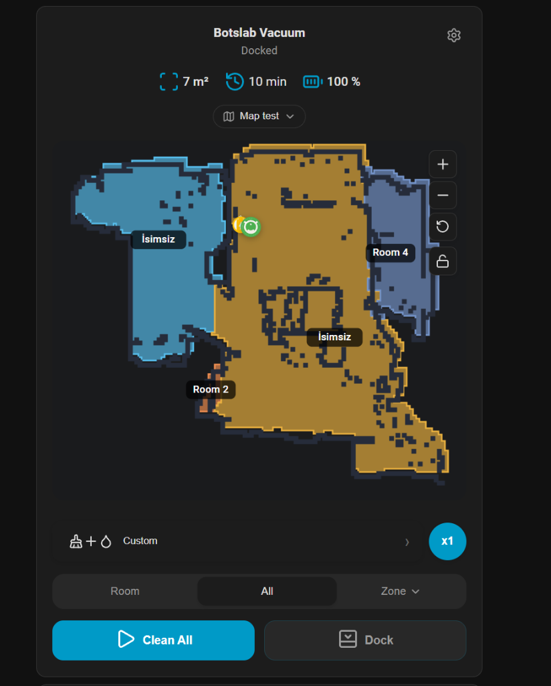
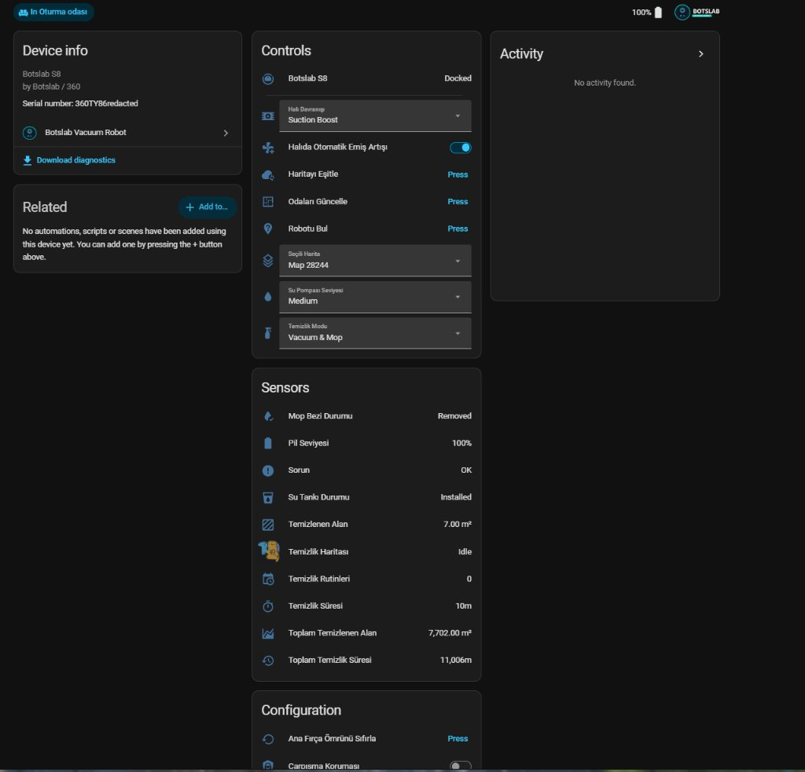
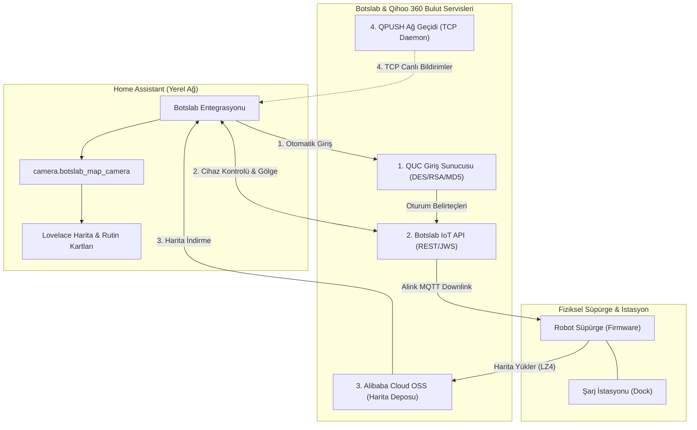
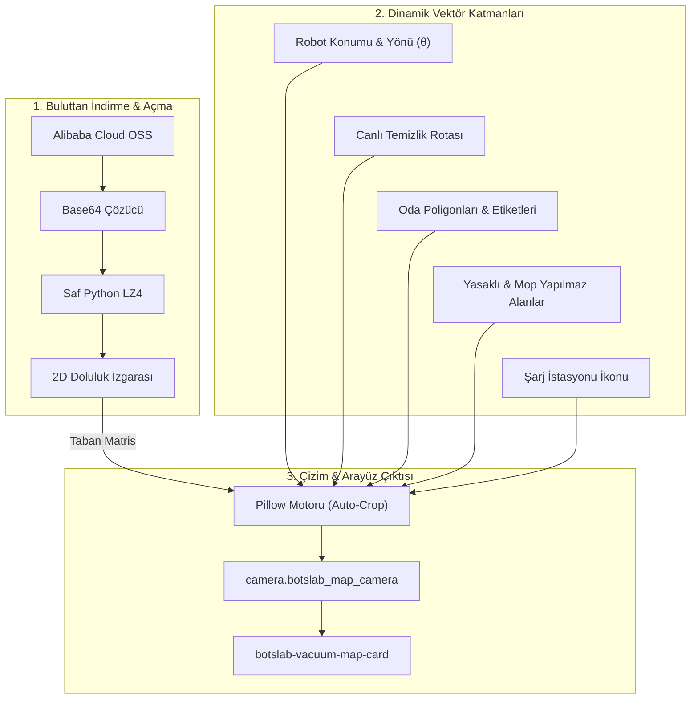

# Botslab Vacuum Robot — Home Assistant Entegrasyonu

[](README.md)
[](#)
[](https://www.home-assistant.io)
[](https://hacs.xyz)
[](LICENSE)
[](https://www.python.org)

**Botslab** ve **Qihoo 360** robot süpürgeleri için hazırlanmış, üretime hazır Home Assistant entegrasyonu. Botslab Bulutuna doğrudan gömülü **QUC Kimlik Doğrulama** (DES + RSA + MD5 imza üretimi) ile bağlanarak süpürge kontrollerini, sensörlerini, oda temizliğini ve canlı telemetrisini Home Assistant'a aktarır.

---

## 📸 Ekran Görüntüleri

<table>
  <tr>
    <td align="center" width="42%">
      <br />
      <sub><b>İnteraktif Harita Kartı</b> (<code>botslab-vacuum-map-card</code>)</sub>
    </td>
    <td align="center" width="58%">
      <br />
      <sub><b>Cihaz Kontrolleri, Sensörler ve Tanılama</b></sub>
    </td>
  </tr>
</table>

---

## 📱 Desteklenen Modeller

| Model | Durum | Notlar |
|---|---|---|
| **Botslab S8** | ✅ **Destekleniyor & Doğrulandı** | Donanım üzerinde test edildi. Tam süpürge kontrolleri, oda temizliği, canlı harita ve sensörler |
| **Qihoo 360 S6** | ✅ **Destekleniyor & Doğrulandı** | Topluluk tarafından Çin Anakara sunucusu üzerinden test edildi ve doğrulandı ([Issue #1](https://github.com/srg-n/ha-botslab-vacuum/issues/1)). Tam kontroller, harita ve sarf malzemeleri |
| **Botslab S8 Plus** | ⚠️ **Test Edilmedi (Çalışması Bekleniyor)** | Aynı TSL bulut API mimarisi — geri bildirim ve testler memnuniyetle karşılanır |
| **Botslab S7 / S9 / S10** | ⚠️ **Test Edilmedi (Çalışması Bekleniyor)** | Uluslararası veya Çin sunucusu üzerinden aynı bulut mimarisi |
| **Qihoo 360 (S5, S7, S9, X90)** | ⚠️ **Deneysel Destek** | Çin Anakara (360 Smart Life) sunucu bölgesi üzerinden protokol desteği |

> 💡 **Hangi Sunucu Bölgesini Seçmelisiniz? (Altın Kural)**
> Bölge seçimi nerede yaşadığınıza değil, **süpürgenizin kayıtlı olduğu mobil uygulamaya** kesin olarak bağlıdır:
> 
> 1. **Eğer süpürgeniz "360 Robot" veya "360 Smart Life" uygulamasındaysa (örn. 360 S5, S6, S7, S9, X90):**
>    - **Seçin:** **`China Mainland (360 Smart Life)` (`cn`)**
>    - ⚠️ **Avrupa'da, Türkiye'de veya Amerika'da yaşıyor olsanız bile**, **`China Mainland (360 Smart Life)`** seçeneğini seçmek **zorundasınız**! Eski 360 süpürgeleri Qihoo'nun merkezi Çin altyapısına (`q.smart.360.cn` / `passport.360.cn`) bağlanır. `Europe 1` seçerseniz *Hesap bulunamadı* hatası alırsınız. Mevcut 360 uygulama e-posta ve şifrenizi kullanın.
> 
> 2. **Eğer süpürgeniz modern "Botslab" uygulamasındaysa (örn. Botslab S8, S8 Plus veya yeni modeller):**
>    - **Seçin:** Coğrafi bölgenizi (örn. Türkiye/Avrupa için **`Asia Pacific`** veya **`Europe 1 (Frankfurt)`**).
>    - Bu modeller modern bölgesel Botslab IoT bulutunu (`*-sapp-api.botslab.com`) kullanır.

---

## 🌟 Temel Özellikler

- 🔐 **Otomatik Giriş & Kendi Kendini İyileştirme:** ADB, root, paket koklama veya proxy gerekmez. Yalnızca Botslab mobil uygulama e-posta ve şifrenizi girmeniz yeterlidir.
- 🔄 **Kendini İyileştiren Oturum Yönetimi (Session Self-Healing):** Mobil uygulama açıldığında oluşan oturum düşmelerini (`102003` *"başka bir cihazda oturum açıldı"*, `1015`) arka planda otomatik olarak yakalar; kayıtlı kimlik bilgileriyle sessizce yeniden tam giriş yaparak komutlarınızı düşürmez ve manuel yeniden giriş gerektirmez.
- 📐 **Kriptografik Bulut-Gölge (Cloud-Shadow) Mimarisi:** Gömülü QUC oturum açma (DES-CBC `parad` + RSA-1024 `key` + MD5 `sig`), dinamik istek imzalama (`md5(appkey + m2 + sign_ts + sign_no + secret)`) ve Base64 JWS yetkilendirme başlığı yönetimi.
- 🧹 **Kapsamlı Süpürge Kontrolleri:**
  - Başlat / Temizle, Duraklat, Durdur, Şarja Dön (Dock)
  - Fan Hızı seçimi (`Quiet`, `Standard`, `Medium`, `Max`)
  - Su Seviyesi seçimi (`Low`, `Medium`, `High`)
  - Temizlik Modu seçimi (`Vacuum & Mop`, `Vacuum Only`, `Mop Only`)
  - Robotu Bul sesli uyarısı (`locate`)
- 🚪 **Dinamik Oda Temizliği & Yasaklı Alanlar (No-Go Zones):**
  - Haritanızdaki bölünmüş odaları otomatik olarak tanır
  - Home Assistant üzerinden oda bazlı temizlik servislerini doğrudan tetikler
  - **Yasaklı & Mop Yapılmaz Alanlar (`SetZones` / `SetFbdPlaces`):** Home Assistant servis çağrıları ve görsel harita kartı üzerinden doğrudan haritaya sanal duvar, girilmez alan ve paspas yapılmaz bölge ekleme/silme
- 🗺️ **Saf Python Harita Motoru & Dahili Kartlar:**
  - Alibaba Cloud OSS üzerinden doğrudan indirme, Base64 çözme ve sıfır bağımlılıklı saf Python LZ4 doluluk ızgarası açma
  - Pillow tabanlı dinamik kenar kırpma (auto-crop) ile gereksiz siyah boşlukları yok etme
  - Yeşil şarj istasyonu ikonu, canlı temizlik rotası ve robotun baktığı yönü gösteren yön oku
  - **Otomatik Yüklenen Dahili Kartlar:**
    - **`botslab-vacuum-map-card`**: Görsel arayüz düzenleyicisi (Visual UI Editor), sıralı oda temizliği (1 -> 2), odaya özel emiş gücü / su debisi ayarı, nokta temizliği ve serbest bölge seçimi sunan modern harita kartı (*noambergauz/dreame-vacuum-map-card* baz alınarak uyarlanmıştır).
    - **`botslab-routines-card`**: Tam teşekküllü Türkçe/İngilizce destekli, görsel düzenleyicili temizlik rutin ve zamanlama yönetim kartı.
- 📡 **Dinamik QPush Ağ Geçidi & Canlı Telemetri:**
  - `dp.push.dc.360.cn` üzerinden dinamik IP çözümü, ham binary TCP Port 443 (öncelikli) ve Port 80 (yedek) bağlantısı
  - Milimetre hassasiyetinde kartezyen konum $[x, y, \theta]$ ve anlık temizlik rotası takibi
- ⏱️ **Çift Kademeli Dinamik Polling & Watchdog Güvenlik Motoru:**
  - **Aktif Temizlik (5s):** 5 saniyelik seri telemetri ve Alibaba OSS `1days` canlı harita akışı
  - **Firmware Güvenlik Watchdog:** 60 saniyelik donanım güvenlik zaman aşımı ve 50 saniyelik keepalive döngüsü (`StartSyncMapPkgToOss`); temizlik bittiğinde derhal sonlandırma (`StopSyncMapPkgToOss`)
  - **Boşta / Şarjda (5 dakika):** Ev Wi-Fi ağını ve robot işlemcisini yormamak için 300 saniyelik rölanti modu; QPush arka plan TCP soketi durum değişiminde Home Assistant'ı anında uyandırır
- ⏱️ **HA Tabanlı Rutin & Zamanlayıcı Motoru:**
  - İstenen günlerde, saatlerde, seçili odalarda ve farklı emiş güçlerinde otomatik temizlik rutinleri
  - Home Assistant dahili hafızasında saklanır (yeniden başlatmalardan etkilenmez)
  - Özel zamanlama sensörü ve Türkçe/İngilizce otomatik dil destekli kontrol kartı
- ⚡ **Dinamik Durum Geçiş Takipçisi (State Transition Watcher):**
  - Komut verildiğinde yapay (iyimser) durumlar uydurmak yerine bulutu 1.5 saniyelik seri aralıklarla kontrol eden döngü
  - Temizlik başladığında veya bittiğinde arayüzde sıfır gecikmeyle anında gerçek durumu yansıtma
- 📊 **Sarf Malzemesi & Bakım Sensörleri:**
  - HEPA Filtre kalan ömrü (saat)
  - Ana Fırça kalan ömrü (saat)
  - Yan Fırça kalan ömrü (saat)
  - Sensör temizleme bakım durumu (saat)
  - Toplam temizlenen alan (m²) ve toplam temizlik süresi (saat)
  - Hata kodu ve tanı durumu
- ⚙️ **Anahtarlar & Ayarlar:**
  - Halı Güç Artırma (Carpet Auto-Boost) anahtarı
  - Çarpışma Koruması anahtarı
  - Buton Işığı anahtarı
  - Ses Seviyesi ayarı (`%0 - %100`)

---

## 🚀 Kurulum

### Seçenek 1: Resmî HACS Varsayılan Deposu (ÖNERİLEN) ⭐

Entegrasyon resmî **HACS varsayılan entegrasyon listesine (Default Repository)** dahil edilmiştir! Artık özel depo URL'si eklemenize gerek kalmadan doğrudan HACS arama çubuğundan bulabilirsiniz:

1. Home Assistant sol menüsünden **HACS** ➔ **Entegrasyonlar** (Integrations) bölümüne girin.
2. Sağ alttaki **Depoları Keşfet ve İndir** (veya büyüteç/arama) butonuna tıklayın.
3. Arama kutusuna **Botslab Vacuum Robot** yazın.
4. Listede çıkan entegrasyona tıklayıp sağ alttaki **İndir** (Download) butonuna basın.
5. **Home Assistant'ı yeniden başlatın** (**Ayarlar ➔ Sistem ➔ Yeniden Başlat**).

---

### Seçenek 2: Özel Depo Ekleme (Custom Repository - Alternatif)

HACS kataloğunuz henüz senkronize olmamışsa veya en güncel git değişikliklerini doğrudan repodan çekmek isterseniz özel depo olarak da ekleyebilirsiniz:

#### Home Assistant Marketplace ile (HA 2026+):
1. Home Assistant sol menüsünden **Marketplace** (veya **Ayarlar ➔ Sistem ➔ Marketplace**) bölümüne girin.
2. Sağ üst köşedeki **üç noktaya** (`⋮`) tıklayın ve **Özel depolar** (Custom repositories) seçeneğini seçin.
3. Depo (Repository) kutusuna bu GitHub URL'sini yapıştırın:
   ```text
   https://github.com/srg-n/ha-botslab-vacuum
   ```
4. Kategori olarak **Entegrasyon** (Integration) seçin ve **Ekle** (Add) butonuna basın.
5. Listede beliren **Botslab Vacuum Robot** kutusuna tıklayıp **İndir / Yükle** (Install) butonuna basın.
6. Home Assistant'ı yeniden başlatın.

#### HACS Özel Depo ile (Legacy):
1. Home Assistant sol menüsünden **HACS** ➔ **Entegrasyonlar** (Integrations) bölümüne girin.
2. Sağ üst köşedeki **üç noktaya** (`⋮`) tıklayın ve **Özel depolar** (Custom repositories) seçeneğini seçin.
3. Depo alanına `https://github.com/srg-n/ha-botslab-vacuum` yapıştırıp kategori olarak **Integration** seçin ve **Add** deyin.
4. Listede **Botslab Vacuum Robot** entegrasyonunu bulup **Download** butonuna basın.
5. Home Assistant'ı yeniden başlatın.

#### Hesap Yapılandırması & Bölge Seçimi:
Yeniden başlatmanın ardından **Ayarlar ➔ Cihazlar ve Hizmetler ➔ Entegrasyon Ekle** bölümüne gidip **Botslab Vacuum** arayın ve giriş yapın:
- **Botslab modelleri için (örn. S8, S8 Plus):**
  - Türkiye veya Orta Doğu hesabı kullanıyorsanız öncelikle **`Asia Pacific`** seçin.
  - Veya hesabınızın ait olduğu bölgeye göre **`Europe 1 (Frankfurt)`**, **`Europe 2`** ya da **`North America`** seçin.
- **Eski Qihoo 360 modelleri için (örn. S5, S6, S7, S9, X90):**
  - Dünyanın neresinde yaşıyor olursanız olun **`China Mainland (360 Smart Life)`** seçin ve 360 Smart Life uygulama bilgilerinizi girin.

---

## 🎨 Home Assistant Dashboard & Dahili Kartlar

Entegrasyon, Home Assistant tarafından doğrudan sunulan **iki dahili Lovelace kartı** ile birlikte gelir. Ayrı bir kart indirme veya Lovelace kaynak (resource) yapılandırması yapmanız gerekmez!

### 1. `botslab-vacuum-map-card` (İnteraktif Harita Kartı)

Botslab robot süpürgeleri için özel olarak geliştirilmiş modern harita kartı:

- **Sıralı Oda Temizliği:** Harita üzerindeki odalara doğrudan tıklayarak seçin. Oda üzerindeki numaralar (`1`, `2`, `3`) temizliğin hangi sırayla yapılacağını gösterir.
- **Otomatik Rota (Auto-Order) Seçeneği:** Odaların seçtiğiniz sırayla mı yoksa robotun hesaplayacağı en kısa rotayla mı temizleneceğini tek tıkla belirleyin.
- **Odaya Özel Ayarlar:** Her oda için bağımsız olarak çekim gücü (Quiet, Standard, Strong, Max), su debisi (Low, Medium, High) ve tekrar sayısı (1x veya 2x) belirleyin.
- **Bölge Temizliği (Zone Clean):** Harita üzerinde dikdörtgen temizlik alanları çizerek sadece o bölgeyi temizletin.
- **Nokta Temizliği (Go To / Spot Clean):** Haritada herhangi bir noktaya tıklayarak süpürgeyi o konuma gönderin.
- **Canlı Katmanlar:** Canlı robot konumu, baktığı yönü gösteren yön oku, yeşil şarj istasyonu ikonu ve anlık temizlik rotası çizgisi.
- **Harita Kontrolleri:** Yakınlaştırma (zoom), kaydırma (pan) ve 90 derecelik açılarla haritayı döndürme butonları.
- **Görsel Kart Düzenleyicisi (Visual Editor):** YAML kodlarıyla uğraşmadan, menüden süpürgenizi seçip anında önizleme alabilirsiniz.

#### Harita Kartını Panonuza Ekleme:
1. Panonuzu açın, sağ üst köşedeki **üç noktaya (⋮)** tıklayıp **Panoyu Düzenle** (Edit Dashboard) deyin.
2. Sağ alttaki **+ Kart Ekle** (+ Add Card) butonuna basın.
3. Arama kutusuna **Botslab** yazın ve **Botslab Vacuum Map Card** seçeneğini seçin.
4. Görsel düzenleyici süpürge ve harita kamerası entity'lerinizi otomatik olarak tanımlar.
5. **Kaydet** butonuna basın!

Veya YAML / Manuel Kart olarak eklemek için:
```yaml
type: custom:botslab-vacuum-map-card
entity: vacuum.botslab_vacuum
map_entity: camera.botslab_map_camera
title: Botslab Vacuum
default_mode: room
# auto_order: false   # false (varsayılan): Robot odaları arayüzde seçtiğiniz sırada temizler (1 -> 2). true: Otomatik rota.
```

---

### 2. `botslab-routines-card` (Temizlik Rutinleri ve Zamanlayıcı)

Zamanlanmış temizlik planlarını doğrudan kontrol panelinizden yönetmenizi sağlayan kart:

- **Rutin Yönetimi:** Mobil uygulamayı açmaya gerek kalmadan yeni temizlik görevleri ekleyin, düzenleyin veya kapatıp açın.
- **Gün ve Saat Seçimi:** Temizliğin başlayacağı saat (SS:DD) ve haftanın tekrarlanacak günlerini belirleyin.
- **Oda ve Güç Seçimi:** Hangi odaların süpürüleceğini, çekim gücünü ve tekrar sayısını rutine özel yapılandırın.
- **Görsel Düzenleyici:** Menüden süpürgenizi seçerek kolayca yapılandırın.
- **Çift Dil Desteği:** Home Assistant kullanıcı dilinize göre otomatik olarak Türkçe veya İngilizce görüntülenir.

#### Rutin Kartını Panonuza Ekleme:
1. Panoyu Düzenle modundayken **+ Kart Ekle** butonuna basın.
2. **Botslab** aratıp **Botslab Routines Card** seçeneğini seçin.
3. Açılır menüden süpürgenizi seçin.
4. **Kaydet** butonuna basın!

Veya YAML / Manuel Kart olarak:
```yaml
type: custom:botslab-routines-card
entity: vacuum.botslab_vacuum
```

---

## 📚 Dokümantasyon & Teknik Referanslar

Derinlemesine protokol analizi, payload şemaları ve mimari detaylar için `docs/` klasöründeki teknik rehberleri inceleyebilirsiniz:

- [Protokol Spesifikasyonu (`docs/PROTOCOL.md`)](docs/PROTOCOL.md) — Ağ protokolü, imzalama algoritmaları, QUC adımları ve Alibaba Cloud OSS / Alink detayları.
- [Kontrol & Payload Referansı (`docs/CONTROL.md`)](docs/CONTROL.md) — Bulut komut kataloğu (`SetFbdPlaces`, `StartCleanInAreas` vb.), servis payload şemaları ve oda temizlik formatları.
- [Entegrasyon Mimarisi (`docs/ARCHITECTURE.md`)](docs/ARCHITECTURE.md) — Sistem akışı, hibrit QPUSH + dinamik polling modeli, Pillow harita motoru ve dahili rutin mimarisi.

---

## 🔬 Teknik Mimari ve Protokol Detayları

Entegrasyon, Botslab cihazlarına tescilli bir **Bulut-Gölge (Cloud-Shadow) Cihaz Mimarisi** üzerinden bağlanır. Robot süpürge yerel ağınızda gelen bağlantıları dinlemez; buluta doğru Alink (Alibaba Cloud IoT) MQTT downlink tünelini sürekli açık tutar.



### 1. Bulut-Gölge (Cloud-Shadow) Cihaz Mimarisi
* **Yerel Ağda Port Açmaz:** Robot süpürge yerel ağınızda doğrudan HTTP/REST sunucusu veya WebSocket portu açmaz. Tüm mobil uygulama ve entegrasyon iletişimi bölgesel bulut API'si (`*-sapp-api.botslab.com`) üzerinden gerçekleşir.
* **Çift Yönlü Gölge Senkronizasyonu:**
  - **Uplink:** Robot süpürge durum parametrelerini (pil seviyesi, çalışma modu, sarf malzeme aşınması, anlık koordinatlar) buluttaki cihaz gölgesine iletir.
  - **Downlink:** Home Assistant komutları `POST /v1/device/service/invoke` ile buluta gönderir; Botslab bulutu bu komutları Alink MQTT tüneli üzerinden doğrudan robotun aktif soketine aktarır.

### 2. Otomatik (Headless) Kimlik Doğrulama
ADB, root veya paket koklama (proxy) gerektirmez. Giriş işlemi arka planda iki adımda otomatik olarak tamamlanır:

| Aşama | Uç Nokta | Kriptografik İşlem | Çıktı |
|---|---|---|---|
| **1. 360 QUC Girişi** | `POST https://passport.360.cn/request.php` (veya bölgesel sunucu) | • Parametreler **DES-CBC** ile şifrelenir (`parad`)<br>• Simetrik anahtar **RSA-1024** ile şifrelenir (`key`)<br>• İstek **MD5** ile imzalanır (`sig`) | Hesap belirteçleri: **`Q`** ve **`T`** |
| **2. Botslab Uygulama Girişi** | `POST https://*-sapp-api.botslab.com/v1/app/login` | • `Q` ve `T` belirteçleri cihaz `m2` donanım kimliğiyle takas edilir | API oturum belirteci: **`sid`** & **`push_alias`** |

### 3. İstek İmzalama ve Yetkilendirme Başlığı
Botslab Bulut API'sine (`*-sapp-api.botslab.com`) gönderilen her istek iki katmanlı kriptografik doğrulama gerektirir:

#### A. Kriptografik Sorgu İmzası (Signed Query)
Her isteğin URL parametrelerinde MD5 ile üretilmiş bir imza yer alır:
```text
sign = MD5(appkey + m2 + sign_ts + sign_no + secret)
```
* **`appkey`**: Mobil istemciye gömülü bölgeye özel uygulama anahtarı.
* **`m2`**: İlk kurulumda üretilen benzersiz cihaz donanım tanıtıcısı.
* **`sign_ts`**: Milisaniye cinsinden Unix zaman damgası (`time.time() * 1000`).
* **`sign_no`**: 16 karakterlik rastgele onaltılık (hex) nonce.
* **`secret`**: İstemci `appkey` değerine karşılık gelen gizli imza anahtarı.

#### B. JWS Yetkilendirme Başlığı (Authorization Header)
Tüm cihaz uç noktaları Base64 ile kodlanmış JSON Web Signature (JWS) başlığı gerektirir:
```http
Authorization: jws <base64({ "q": "<Q>", "t": "<T>", "sid": "<sid>" })>
```

### 4. Kendini İyileştiren Otomatik Oturum Yönetimi (Session Self-Healing)
> [!IMPORTANT]
> **Tekil Oturum Kuralı:** Botslab bulut mimarisi hesap başına aynı anda tek bir aktif oturuma izin verir. Telefonunuzda resmî Botslab mobil uygulamasını açtığınızda Home Assistant'ın oturumu sonlandırılır ve API `102003` (*"başka bir cihazda oturum açıldı"*) veya `1015` (*"geçersiz/eksik oturum"*) kodunu döndürür.

* **Otomatik Yakalama:** Entegrasyon tüm oturum düşme hata kodlarını (`100003`, `102008`, `102003`, `1015`, `1002`, `1003`, `401`) otomatik olarak yakalar.
* **Arka Planda Şeffaf Yenileme:** Oturum düştüğünde koordinatör kayıtlı kimlik bilgileriyle arka planda sessizce yeniden tam giriş yapar, `Q`, `T` ve `sid` belirteçlerini günceller ve bekleyen kullanıcı komutunu veya durum sorgusunu tekrar dener.
* **Kesintisiz Kullanım:** Aile bireyleri telefon uygulamasını açsa dahi Home Assistant süpürge kontrolünü hiçbir zaman kaybetmez; kullanıcıya hata uyarısı veya yeniden giriş bildirimi yansıtılmaz.

### 5. Alibaba Cloud OSS Harita Hattı ve Sunucu Taraflı Çizim
Harita kareleri doğrudan Alibaba Cloud Object Storage Service (OSS) üzerinden indirilir ve saf Python kullanılarak sunucu tarafında çizilir:



1. **OSS İndirme:** En güncel harita paketi için bulut gölgesinden ön imzalı indirme bağlantısı alınır (`MapPkgOssInfo`).
2. **Saf Python LZ4 Açıcı:** Harita paketi Base64 ile kodlanmış LZ4 sıkıştırmalı 2D doluluk ızgarası içerir. Harici bağımlılık gerektirmeyen gömülü saf Python LZ4 blok açıcımız bayt akışını doğrudan bellekte açar.
3. **Pillow Vektör Katman Motoru:**
   - **Otomatik Kırpma (Auto-Crop):** Geniş siyah kenar boşluklarını otomatik tespit ederek kırpar.
   - **Oda Bölümleme:** Ayrıştırılmış odaları renk kodlarıyla boyar ve merkez etiket koordinatlarını hesaplar.
   - **Donanım Katmanları:** Şarj istasyonunu, sanal duvarları ve paspas yapılmaz bölgeleri işler.
   - **Anlık Telemetri:** Canlı temizlik rotasını ve robotun güncel baktığı yön açısını ($\theta$) yön okuyla çizer.
4. **HA Çıktısı:** Home Assistant'ta standart `camera` varlığı olarak sunulur; harita revizyon sayacı sayesinde `botslab-vacuum-map-card` arayüzünde anında güncellenir.

### 6. Qihoo QPUSH Protokolü
* **Protokol:** Anlık durum bildirimleri için kullanılan tescilli ikili TCP itme protokolüdür.
* **Ağ Geçidi Keşfi:** Bölgesel push sunucu IP'leri `dp.push.dc.360.cn?appId=gqrwex6nq54m` sorgusuyla dinamik keşfedilir; Port 443 (öncelikli) veya Port 80 (yedek) üzerinden kalıcı ham binary TCP bağlantısı kurulur.
* **Çift Kademeli Polling Stratejisi:**
  - **Aktif Temizlik (5s):** Canlı harita akışıyla senkronize 5 saniyelik seri telemetri sorgusu.
  - **Boşta / Şarjda (5 dakika):** Ağ bant genişliğini ve robot işlemcisini korumak için 300 saniyelik rölanti modu; gelen QPUSH `OP_PUSH` paketleriyle anında uyandırılır.

### 7. Alibaba Cloud (Aliyun) Alink ve Downlink Komutları
* Botslab S8/S10 robotları **Alibaba Cloud IoT (Alink)** platformunu kullanır ve bölgesel Alibaba broker'ı ile sürekli aktif bir MQTT soketi tutar.
* `start_clean`, `pause`, `clean_rooms` gibi servis çağrıları Botslab bulut tüneli üzerinden Alink downlink paketlerine dönüştürülerek robotu uykudan anında uyandırır.
* **DeviceSecret Neden Gerekli Değildir?**
  - `DeviceSecret` anahtarı üretim aşamasında robotun donanımsal EEPROM hafızasına kazınır ve dışarı sızdırılmaz.
  - Alink platformu cihaz adı başına yalnızca tek bir aktif MQTT oturumuna izin verir: cihaz gibi bağlanmaya çalışmak evinizdeki fiziksel robotun bağlantısını koparacaktır.
  - Bu sebeple entegrasyon, mobil uygulamanın kullandığı resmî `invoke_service` bulut tünelini kullanır.

### 8. Resmî Uygulamanın İletişim Kurduğu Uç Noktalar

| Sunucu | Amaç | Entegrasyon Kullanıyor mu? |
|---|---|---|
| `*-sapp-api.botslab.com` | Cihaz listesi, özellikler, `invoke_service` komutları, harita bilgisi | **Evet** (Ana API) |
| `*-sapp-login.botslab.com` / `passport.360.cn` | QUC e-posta/şifre kimlik doğrulama & oturum açma | **Evet** (Kimlik Doğrulama) |
| `*-ali-*-days.oss-*.aliyuncs.com` | Canlı harita paketleri ve kayıtlı kat planları | **Evet** (Harita Motoru) |
| `dp.push.dc.360.cn` | Dinamik QPush ağ geçidi IP çözümleme | **Evet** (QPUSH) |
| `q.smart.360.cn` | Eski Qihoo 360 Çin sunucusu (S5, S6, S7, S9, X90) | **Evet** (Çin Anakara) |
| `eu1-video-iotext.botslab.com` | Firmware ikili dosya indirmeleri | Hayır (OTA) |
| `eu1-ad2-app.botslab.com`, `ad.iot.360.cn` | Mobil reklamlar | Hayır |
| `eu1-logs-app.botslab.com`, `qos.live.360.cn` | Analitik ve hata günlükleri | Hayır |

### 9. Stabilite Uyarısı

> [!WARNING]
> Bu entegrasyon resmî Android uygulamasından tersine mühendislikle elde edilen imza anahtarlarına ve tescilli bulut uç noktalarına dayanır. Entegrasyon kapsamlı hata toleransı ve kendi kendini iyileştirme mekanizmalarıyla donatılmış olsa da Botslab'ın sunucu protokolünde yapacağı değişiklikler entegrasyonun güncellenmesini gerektirebilir.

---

## 👏 Teşekkür & Krediler (Credits)

- **[Noam Bergauz](https://github.com/noambergauz)** — Entegrasyonla birlikte gelen `botslab-vacuum-map-card`, Noam Bergauz'un harika [noambergauz/dreame-vacuum-map-card](https://github.com/noambergauz/dreame-vacuum-map-card) projesinden uyarlanmış; Botslab oda bölümlemeleri, canlı yön kalibrasyonu ve servislerine entegre edilmiştir.
- **Qihoo 360 & Botslab Topluluğu** — Eski 360 S6 / S7 protokollerinin test edilmesinde ve geliştirilmesinde katkı sunan tüm topluluk üyelerine teşekkürler.

---

## 🤝 Katkıda Bulunma & Lisans

Yalnızca Botslab S8 modeli doğrulandığı için diğer modellerle (S8 Plus, S7, S9, S10) test sonuçları ve pull request'ler memnuniyetle karşılanır!  
Bu proje [MIT Lisansı](LICENSE) ile açık kaynak olarak sunulmuştur.
