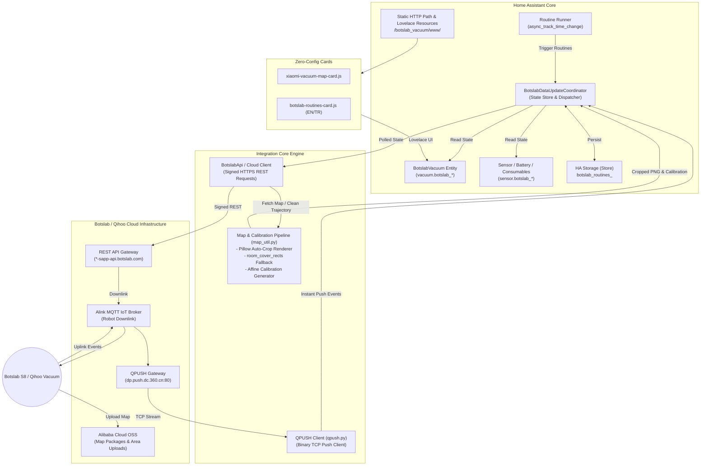

# Botslab Vacuum Integration Architecture

This document describes the internal architecture, dataflow, synchronization models, map rendering pipeline, and frontend delivery mechanisms of the **Botslab Vacuum** Home Assistant custom component.

> ℹ️ **Verified Hardware:** Primary architecture validated on the **Botslab S8**. Legacy Qihoo architecture validated on the **360 S6** ([Issue #1](https://github.com/srg-n/ha-botslab-vacuum/issues/1)).

---

## 1. System Overview & Component Diagram



---

## 2. Hybrid Push-and-Poll Synchronization Model

The integration avoids slow updates while minimizing unnecessary API polling through a dual-channel design:

### 2.1. Inbound Push Channel (`qpush.py`)
- Maintains a lightweight, persistent binary TCP connection to `dp.push.dc.360.cn:80`.
- Encapsulates payload using Qihoo 360 binary framing (`magic 0x36 0x30`, command IDs, length headers).
- Decodes push notifications sent by the vacuum (cleaning started, cleaning paused, docked, error alerts, battery updates).
- On push receipt, `qpush.py` triggers an immediate reactive callback into `BotslabDataUpdateCoordinator.async_set_updated_data()`.
- Latency from physical robot state changes to Home Assistant entity state updates: **< 500 ms**.

### 2.2. Adaptive Polling Channel (`BotslabDataUpdateCoordinator`)
- Acts as a fallback and state reconciliation loop.
- **Adaptive intervals:**
  - **120 seconds** when robot is docked / idle / sleeping.
  - **30 seconds** when robot is actively cleaning (`dev_is_active`), fetching updated cleaning tracks and map progress.
- Backs off gracefully if network errors occur.

### 2.3. Dynamic State Transition Watcher (`watch_state_transition`)
- Eliminates command latency when starting, pausing, or docking the vacuum.
- When an action is sent, rather than displaying an unverified (fake) optimistic state, the coordinator initiates a rapid verification loop polling every **1.5 seconds** (up to 8 attempts / ~12 seconds) until the robot's real status transition is published to the cloud.
- Once the real status changes (e.g. `docked` ➔ `cleaning`), the loop self-terminates immediately and active polling takes over.

---

## 3. Map Processing & Calibration Pipeline (`map_util.py`)

The integration features an advanced, standalone map rendering engine powered by Pillow:

### 3.1. Raw Map Decomposition
1. Cloud returns either a pre-rendered base map image or raw cell grid / floor plan data from Alibaba Cloud OSS.
2. The grid distinguishes between walls (`2`), open traversable space (`1`), unknown areas (`0`), and segmented room partitions.

### 3.2. Pillow Auto-Crop & High-Resolution Renderer (`render_map_advanced`)
- **Bounding Box Auto-Crop:** Scans the occupancy grid for min/max row and column bounds with added safety margins, eliminating useless black void borders.
- **Dynamic Scale Factor:** Scales cropped pixels (default 3x) for crisp rendering on high-DPI smartphone and tablet screens.
- **Visual Overlays:**
  - **Room Fills & Labels:** Distinct pastel color fills per room partition.
  - **No-Go Zones:** Semi-transparent red fills (`rgba(255, 60, 60, 80)`) with solid red outlines.
  - **Dock Station Glyphs:** High-visibility green station markers (`#00E676`) with docking pin indicator.
  - **Cleaning Trajectory (`cleaning_path`):** Multi-segment polyline path rendered in high-contrast cyan (`#00E5FF`).
  - **Robot Marker & Heading:** Solid orange circular glyph (`#FF6D00`) with white border and a directional arrow indicating current robot orientation (`robot_pose.phi`).

### 3.3. Affine Calibration Matrix Generator
- Maps robot millimeter coordinates $(x, y)$ to card pixel coordinates $(u, v)$:
  $$u = (x_{mm} - c_{min}) \cdot scale$$
  $$v = (r_{max} - y_{mm}) \cdot scale$$
- Provides precise 3-point calibration triplets (`calibration_points`) formatted for direct consumption by `xiaomi-vacuum-map-card`.

### 3.4. Histogram Room-Cover Fallback (`room_cover_rects`)
- When a model firmware does not support polygon room cleaning payloads (`StartCleanInAreas`), the integration automatically rasterizes room polygons and decomposes them into the minimal set of rectangular bounding boxes using a largest-rectangle histogram algorithm.
- Passes the decomposed rectangles to standard zone cleaning (`clean_zone`).

---

## 4. HA-Driven Routine & Schedule Engine

Rather than relying on vendor cloud timer limitations (often limited to 3-5 basic timers with no room selection support), the integration provides an internal, robust routine scheduler:

1. **Persistent Storage:**
   - Stored in Home Assistant configuration directory via `hass.helpers.storage.Store(STORAGE_VERSION, f"botslab_routines_{entry_id}")`.
   - Routines survive HA restarts, core upgrades, and offline periods.
2. **Time Tracking (`async_track_time_change`):**
   - Evaluates active routines every minute (`second=0`).
   - Matches current day of week (`mon`, `tue`, `wed`, `thu`, `fri`, `sat`, `sun`) and target time (`HH:MM`).
3. **Execution Dispatch:**
   - Automatically checks if robot is already cleaning or available.
   - Adjusts suction mode (`quiet`, `standard`, `strong`, `max`) and pass count (1x or 2x).
   - Executes target room IDs or falls back to full auto clean.
4. **Sensor Surface:**
   - Exposed to Lovelace via `BotslabSchedulesSensor` (`sensor.botslab_schedules_<dev_id>`), detailing routine count and execution state.

---

## 5. Zero-Config Frontend Asset Delivery

Users do not need to manually clone HACS repositories or configure Lovelace JavaScript resources in YAML:

1. **Static HTTP Handler:**
   - On integration startup, `__init__.py` registers `/botslab_vacuum/www/` with Home Assistant's internal HTTP server (`hass.http.register_static_path`).
2. **Automatic Resource Registration:**
   - Hooks into `hass.data["lovelace"].resources` (or storage collection).
   - Automatically registers:
     - `/botslab_vacuum/www/xiaomi-vacuum-map-card.js`
     - `/botslab_vacuum/www/botslab-routines-card.js` (with automatic EN/TR localization).
3. **Card Version Tracking:**
   - Embeds package version query parameters to ensure browser cache busting upon integration updates.

---

## 6. Directory Structure

```
custom_components/botslab_vacuum/
├── __init__.py               # Setup, teardown, service & resource registration, routine loop
├── api.py                    # BotslabApi, request signing, OSS upload, zone fallback
├── config_flow.py            # UI setup flow, QUC login, multi-device selection
├── const.py                  # Protocol constants, services, domains, intervals
├── coordinator.py            # BotslabDataUpdateCoordinator, push/poll merge, routine store
├── diagnostics.py            # Sensitive-data-redacted diagnostics dump for HA issues
├── exceptions.py             # Custom integration exceptions (Auth, Network, Protocol)
├── lovelace.py               # Lovelace card generators & helper definitions
├── map_util.py               # Pillow rendering, auto-crop, calibration, cover rects
├── models.py                 # Dataclasses: BotslabVacuumDevice, BotslabMapInfo, etc.
├── qpush.py                  # Binary TCP push client to dp.push.dc.360.cn:80
├── sensor.py                 # Sensors: battery, filters, brushes, schedules
├── services.yaml             # HA Service schemas & descriptions
├── vacuum.py                 # StateVacuumEntity implementation
├── translations/             # Multilingual translations (en.json, tr.json, strings.json)
└── www/                      # Bundled Lovelace cards & third-party notices
    ├── botslab-routines-card.js
    ├── xiaomi-vacuum-map-card.js
    └── THIRD_PARTY.md
```
